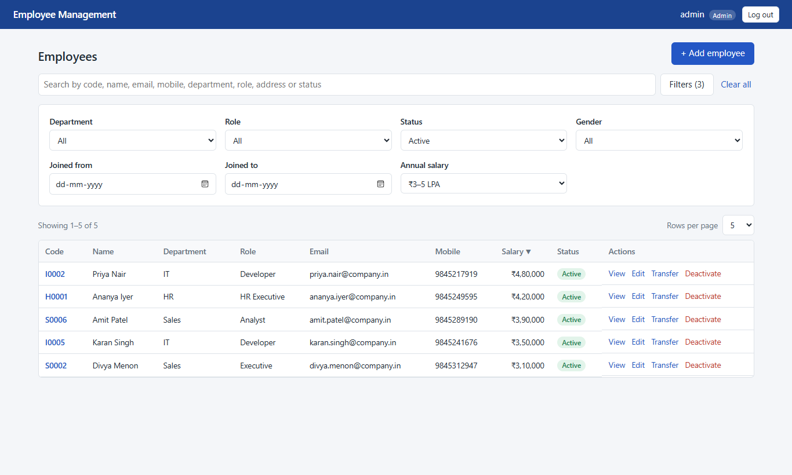
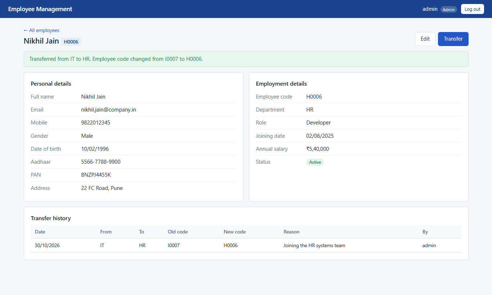

# Employee Management System

This is my solution to the Full Stack Developer Intern assessment. It is a web app for managing employees: add, view, edit and deactivate employees, search and filter the list, and transfer employees between departments. Employee codes are generated automatically from the department (I0001, H0001 and so on).

- **Frontend:** React 19 + Vite (plain CSS, no UI library)
- **Backend:** ASP.NET Core 8 Web API (C#), EF Core 8
- **Database:** SQL Server 2022 Express
- **Auth:** JWT with three roles: Admin, Manager and Employee

GitHub: https://github.com/Adarsh041-arch/EMPLOYEE_MANAGEMENT_SYSTEM

## Screenshots

| Employee list with filters | Details after a transfer |
| --- | --- |
|  |  |

More screenshots are in `docs/screenshots/`, and the full write-up is in `docs/Solution_Report.pdf`.

## Project structure

```
backend/
  EmployeeManagement.sln
  EmployeeManagement.Api/        Web API project
    Controllers/                 Auth, Employees, Lookups (departments + roles)
    Services/                    EmployeeService, TransferService, EmployeeCodeGenerator,
                                 AuthService, SensitiveDataProtector (Aadhaar/PAN encryption)
    Data/                        AppDbContext, DataSeeder (sample data)
    Models/  DTOs/  Validators/  Middleware/ (error handling)
    Migrations/                  EF Core migrations
  EmployeeManagement.Tests/      xUnit tests (validators + API tests against SQL Server)
frontend/                        React app (src/pages, src/components, src/api ...)
database/
  schema.sql                     full schema, generated from the EF migration
  seed.sql                       sample data (22 employees, 3 users, 4 transfers)
  export-seed.ps1                script I used to produce seed.sql
docs/
  Solution_Report.pdf
  EmployeeManagement.postman_collection.json
  swagger.json
  screenshots/
```

## Prerequisites

| Tool | Version I used | Download |
| --- | --- | --- |
| .NET SDK | 8.0 (8.0.427) | https://dotnet.microsoft.com/download/dotnet/8.0 |
| SQL Server | 2022 Express (any edition, or LocalDB, works) | https://www.microsoft.com/sql-server/sql-server-downloads |
| Node.js | 20 or newer (I used 24.19.0, npm 11.17.0) | https://nodejs.org |

On Windows the SDK and SQL Server Express can also be installed with winget:

```
winget install Microsoft.DotNet.SDK.8
winget install Microsoft.SQLServer.2022.Express
```

## Running the project

### 1. Configure the backend

```
cd backend/EmployeeManagement.Api
copy appsettings.example.json appsettings.Development.json
```

`appsettings.example.json` has sample keys that are fine for running locally. For anything beyond a demo, put your own values in `appsettings.Development.json` (this file is git-ignored):

- `Jwt:Key`: any random string, at least 32 characters
- `Encryption:Key`: 32 random bytes in base64, used to encrypt Aadhaar and PAN. One way to make one in PowerShell:
  `$b = New-Object byte[] 32; [Security.Cryptography.RandomNumberGenerator]::Create().GetBytes($b); [Convert]::ToBase64String($b)`

The connection string is in `appsettings.json`:

```
Server=.\SQLEXPRESS;Database=EmployeeManagement;Trusted_Connection=True;TrustServerCertificate=True
```

It uses Windows authentication, so no password is stored. If your SQL Server instance has a different name (for example `(localdb)\MSSQLLocalDB` or `localhost`), change `Server=`. If you use SQL logins, change it to `User Id=...;Password=...`, and keep that version in `appsettings.Development.json`, not in `appsettings.json`.

### 2. Run the API

```
cd backend
dotnet restore
dotnet run --project EmployeeManagement.Api --launch-profile http
```

On first start the API applies the EF Core migration (which creates the database and tables) and adds the sample data. It runs on **http://localhost:5005**, and Swagger is at **http://localhost:5005/swagger**.

### 3. Run the frontend

In a second terminal:

```
cd frontend
npm ci
npm run dev
```

Open **http://localhost:5173**. Vite forwards `/api` requests to the API on port 5005, so both need to be running.

### Demo logins

| Username | Password | Role | Can do |
| --- | --- | --- | --- |
| admin | Admin@123 | Admin | everything; the only role that sees full Aadhaar/PAN and can deactivate |
| manager | Manager@123 | Manager | add, edit and transfer employees; sees masked Aadhaar/PAN; cannot deactivate or edit their own record |
| employee | Employee@123 | Employee | read-only, and only their own record (Priya Nair) |

### Option: create the database from SQL scripts instead

If you'd rather not let the app create the database, run the scripts yourself (SSMS, Azure Data Studio or sqlcmd):

```
CREATE DATABASE EmployeeManagement;
-- then, in that database:
database/schema.sql
database/seed.sql
```

`seed.sql` contains Aadhaar/PAN values encrypted with the sample `Encryption:Key` from `appsettings.example.json`, so keep that key if you use the script. With your own key, let the app seed the database instead. It only seeds when the Employees table is empty.

Migrations can also be applied without starting the app:

```
dotnet tool restore
dotnet ef database update --project backend/EmployeeManagement.Api
```

## Running the tests

```
cd backend
dotnet test
```

There are 68 tests. The API tests start the real API in memory and run it against a separate database, `EmployeeManagement_Test`, on `.\SQLEXPRESS`. That database is dropped and re-created on each run. They cover code generation (including 10 parallel creates in one department), transfers (including two parallel transfers of the same employee), search/filter/paging, roles and validation errors.

```
cd frontend
npm test
```

These are 33 tests for the form validation rules (including the date checks), Aadhaar auto-formatting and the salary range presets.

## API overview

All endpoints except login need `Authorization: Bearer <token>`.

| Method | URL | Who | Notes |
| --- | --- | --- | --- |
| POST | /api/auth/login | anyone | returns the JWT |
| GET | /api/employees | all roles | search, filters, sorting, paging (see below) |
| GET | /api/employees/{id} | all roles | Employee role: own record only |
| GET | /api/employees/{id}/personal-details | all roles | Aadhaar/PAN masked unless Admin |
| POST | /api/employees | Admin, Manager | employee code is generated |
| PUT | /api/employees/{id} | Admin, Manager | department changes go through transfer |
| DELETE | /api/employees/{id} | Admin | sets status to Inactive; `?hard=true` deletes, but only if the employee has no transfer history |
| POST | /api/employees/{id}/transfer | Admin, Manager | new department gives a new code, same Id |
| GET | /api/employees/{id}/transfers | all roles | transfer history |
| GET | /api/departments, /api/roles | all roles | dropdown data |

List query parameters: `search`, `departmentId`, `roleId`, `status` (Active / Inactive / OnLeave), `gender`, `joiningFrom`, `joiningTo`, `minSalary`, `maxSalary`, `sortBy` (code, name, department, role, email, mobile, salary, joiningDate, status), `sortDir` (asc / desc), `pageNumber`, `pageSize` (5, 10 or 20).

Example from the brief:

```
GET /api/employees?search=Rahul&departmentId=1&minSalary=300000&maxSalary=500000&pageNumber=1&pageSize=10
```

The response looks like `{ items, totalCount, pageNumber, pageSize, totalPages }`. Errors come back as ProblemDetails JSON with status codes 400, 401, 403, 404, 409 or 500, plus field errors where relevant.

The Swagger UI documents the API, and `docs/swagger.json` has the spec. To use Postman, import `docs/EmployeeManagement.postman_collection.json`. Run "Login (admin)" first and it saves the token for the other requests.

## How the main parts work

**Employee codes.** Each department has a row in `EmployeeCodeSequences` with the last number used. Creating an employee runs, inside a transaction:

```sql
UPDATE EmployeeCodeSequences SET LastNumber = LastNumber + 1
OUTPUT inserted.LastNumber WHERE DepartmentId = @dept
```

The update locks that row until the transaction commits, so two requests for the same department can't get the same number. The code is the prefix plus a 4-digit number (`I0007`). There is also a unique index on `EmployeeCode` as a final safety net.

**Transfers.** These run in one serializable transaction. The API checks that the new department is different, takes the next code from the new department's sequence, updates the department and code (the `Id` stays the same) and writes a row to `EmployeeTransferHistory` with the old and new department and code, date, reason and who did it. If anything fails, the whole transfer rolls back. In the sample data, Rahul Sharma (I0001) was moved to HR and is now H0005.

**Sensitive data.** Aadhaar and PAN are encrypted with AES-GCM before they are stored. The last 4 Aadhaar digits and a masked PAN are stored separately for display. Only Admin users get the decrypted values. Global search never looks at Aadhaar or PAN. Passwords are hashed with BCrypt.

**Search and filters** all run on the server and combine with AND. Search matches part of the code, name, email, mobile, department, role, address or status. The frontend keeps every filter in the URL, so a refresh or a shared link shows the same results.

## Dependencies

Backend NuGet packages (`backend/EmployeeManagement.Api/EmployeeManagement.Api.csproj`):

| Package | Version | Used for |
| --- | --- | --- |
| Microsoft.EntityFrameworkCore.SqlServer | 8.0.11 | EF Core + SQL Server provider |
| Microsoft.EntityFrameworkCore.Design | 8.0.11 | migrations (`dotnet ef`) |
| Microsoft.AspNetCore.Authentication.JwtBearer | 8.0.11 | JWT authentication |
| Swashbuckle.AspNetCore | 6.6.2 | Swagger / OpenAPI |
| FluentValidation.AspNetCore | 11.3.0 | request validation |
| BCrypt.Net-Next | 4.0.3 | password hashing |

Test project (`backend/EmployeeManagement.Tests`): xunit 2.5.3, xunit.runner.visualstudio 2.5.3, Microsoft.NET.Test.Sdk 17.8.0, Microsoft.AspNetCore.Mvc.Testing 8.0.11, coverlet.collector 6.0.0.

Tool (`.config/dotnet-tools.json`): dotnet-ef 8.0.11.

Packages are restored from nuget.org (`nuget.config`) with `dotnet restore`, and `dotnet tool restore` installs the tools.

Frontend (`frontend/package.json`, exact versions in `package-lock.json`):

| Package | Version |
| --- | --- |
| react / react-dom | 19.3.1 |
| react-router-dom | 6.28.0 |
| axios | 1.7.9 |
| react-hook-form | 7.54.2 |
| zod | 3.24.1 |
| @hookform/resolvers | 3.9.1 |
| vite (dev) | 6.4.5 |
| @vitejs/plugin-react (dev) | 4.7.0 |
| vitest (dev) | 2.1.8 |
| eslint (dev) | 9.39.5 |

`npm ci` installs the exact versions from the lockfile.

## Assumptions and decisions

- "Delete" deactivates the employee (status becomes Inactive) so their history is kept. Admins can still delete permanently with `?hard=true`, but only employees who were never transferred, so transfer history is never lost (otherwise 409).
- A department can't be changed through Edit. It has to go through Transfer so the code and history stay correct.
- When editing, Aadhaar/PAN can be left blank to keep the stored values. Managers only see masked values, so they couldn't send the originals back anyway.
- The salary presets follow the brief: "₹1–3 LPA" means ₹1,00,000 up to but not including ₹3,00,000. The API's `minSalary`/`maxSalary` are both inclusive, so the frontend sends ₹2,99,999.99 as the max for that preset.
- Page size is limited to 5, 10 or 20, as the brief asks. Other values return 400.
- Swagger is enabled in every environment because this is a demo project.
